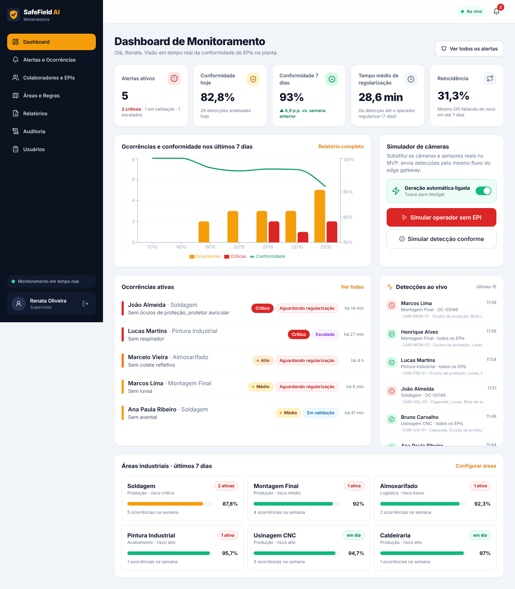

# SafeField AI · Metaindústria

**Monitoramento proativo de EPIs e riscos operacionais em campo industrial.**
Challenge 2026 FIAP × SPI Integração · Sprints 1 a 4.



| | |
|---|---|
| **Repositório** | https://github.com/CaioTSFaraleski/Sprint-1-4-2026 |
| **Board Trello (Scrum)** | https://trello.com/b/LvmH9MTx/safefield-ai-metaind%C3%BAstria-sprint-3-scrum |
| **Protótipo no Figma** | [SafeField AI · Metaindústria Dashboard](https://www.figma.com/design/d6wRQPPhz9r50kVu5zJFOe/SafeField-AI--Metaind%C3%BAstria-Dashboard?node-id=0-1&t=gfM8x4VZIW0N3Z67-1) |
| **Vídeo de pitch e demonstração** | _(link do YouTube, não listado)_ |

## Integrantes

| Nome | RM |
| --- | --- |
| Pedro Alvarez Certo | 554603 |
| Caio Tadeu Da Silva Faraleski | 558795 |
| Gustavo Demeis Peres | 555143 |
| Rodrigo Caruzzo Benevides | 554665 |
| Eduardo do Nascimento Souza | 558819 |

## Sumário

1. [Problema e proposta de solução](#1-problema-e-proposta-de-solução)
2. [Como executar](#2-como-executar)
3. [Como usar: roteiro de avaliação em 5 minutos](#3-como-usar-roteiro-de-avaliação-em-5-minutos)
4. [O que foi entregue](#4-o-que-foi-entregue)
5. [Arquitetura e tecnologias](#5-arquitetura-e-tecnologias)
6. [Evolução por Sprint](#6-evolução-por-sprint)
7. [Documentação do projeto](#7-documentação-do-projeto)
8. [Estrutura do repositório](#8-estrutura-do-repositório)

---

## 1. Problema e proposta de solução

O Challenge propõe uma **Metaindústria**, em que os ambientes físico e digital da fábrica operam de forma
integrada. Na segurança do trabalho, isso significa sair do modelo **reativo e punitivo**, em que a falha só
aparece numa auditoria ou depois de um acidente, para um modelo **proativo, contínuo e orientado por dados**.

**Problema:** acompanhar em tempo real o uso correto de EPIs e a exposição dos operadores a riscos em várias
frentes de trabalho ao mesmo tempo. A não conformidade acontece por pressa, esquecimento, troca de área ou falta
de visibilidade do supervisor, e normalmente só é descoberta tarde demais.

**Solução: SafeField AI.** Câmeras com visão computacional e sensores (o *edge gateway*) informam quais EPIs
cada operador está usando. O sistema compara essa leitura com as **regras de segurança da área e do turno** e,
se faltar algo:

1. abre uma **ocorrência** com a severidade calculada (regra violada, quantidade de EPIs faltando e reincidência);
2. envia **alerta em tempo real** ao operador (tablet/PWA) e ao supervisor da área (painel);
3. acompanha a **regularização** pelo operador e a **validação humana** pelo supervisor, já que nenhuma
   detecção automática encerra ou pune sozinha;
4. registra tudo numa **trilha de auditoria imutável** e consolida **indicadores e relatórios de conformidade**
   para o gestor decidir onde investir em prevenção e treinamento.

| Ator | O que o SafeField AI entrega |
|---|---|
| **Operador** | Alerta objetivo do EPI que falta, orientações da área e confirmação de regularização com um toque. |
| **Supervisor de segurança** | Painel ao vivo, priorização por severidade, validação, escalonamento e histórico por colaborador. |
| **Gestor industrial** | Indicadores de conformidade, tempo de regularização e reincidência por área, turno e EPI, com exportação. |
| **Visão computacional / sensores** | API autenticada para publicar detecções (`POST /api/v1/deteccoes`). |

## 2. Como executar

A aplicação tem dois módulos: **API** (Java 21 + Spring Boot) e **interface web** (React + TypeScript). Os
dados de demonstração da Metaindústria (24 colaboradores, 6 áreas, 10 EPIs com CA, regras por área e turno e
**30 dias de histórico**) são criados automaticamente na inicialização, e um **simulador de câmeras** gera
novas detecções a cada 25 segundos.

### Opção A: Docker (recomendada, um comando)

Pré-requisito: [Docker Desktop](https://www.docker.com/products/docker-desktop/) (ou Docker Engine + Compose v2).

```bash
git clone https://github.com/CaioTSFaraleski/Sprint-1-4-2026.git
cd Sprint-1-4-2026
docker compose up --build
```

Quando o log da API mostrar `Dados de demonstração da Metaindústria criados`, acesse:

- **Aplicação:** http://localhost:3000
- **Documentação da API (Swagger):** http://localhost:8080/swagger-ui.html

São três containers: `postgres` (PostgreSQL 16), `api` (Spring Boot) e `web` (Nginx servindo o React e
encaminhando `/api` e `/ws` para a API). Para encerrar, use `Ctrl+C` e depois `docker compose down`.

### Opção B: sem Docker (Java + Node)

Pré-requisitos: **JDK 21** e **Node.js 18 ou superior**. O Maven não precisa estar instalado, porque o projeto
inclui o Maven Wrapper. Nesse modo a API usa banco **H2 em memória**.

**Linux / macOS**, com um comando:

```bash
./iniciar.sh
```

**Windows:**

```bat
iniciar.cmd
```

Ou manualmente, em dois terminais:

```bash
# terminal 1: API em http://localhost:8080
cd backend
./mvnw spring-boot:run          # no Windows: mvnw.cmd spring-boot:run

# terminal 2: interface em http://localhost:5173
cd frontend
npm install
npm run dev
```

Acesse **http://localhost:5173** depois que a API mostrar `Dados de demonstração da Metaindústria criados`.

### Contas de demonstração

Todas usam a senha **`safefield123`**. A tela de login também tem botões de acesso rápido.

| Perfil | E-mail | Persona (Sprint 1) |
|---|---|---|
| Supervisora de segurança | `supervisor@metaindustria.com.br` | Renata Oliveira |
| Gestor industrial | `gestor@metaindustria.com.br` | Marcelo Torres |
| Operador (Montagem Final) | `operador@metaindustria.com.br` | Marcos Lima |

### Testes automatizados

```bash
cd backend && ./mvnw test        # 11 testes: motor de regras + fluxo completo pela API
cd frontend && npm test          # testes de formatação (datas no fuso da planta, percentuais)
```

### Configurações úteis (variáveis de ambiente da API)

| Variável | Padrão | Para quê |
|---|---|---|
| `SAFEFIELD_SIMULADOR_ATIVO` | `true` | Liga/desliga o simulador de câmeras (também dá para alternar no Dashboard). |
| `SAFEFIELD_SIMULADOR_INTERVALO_MS` | `25000` | Intervalo entre detecções simuladas. |
| `SAFEFIELD_GATEWAY_KEY` | `gateway-dev-key` | Chave que o edge gateway envia em `X-Gateway-Key`. |
| `SAFEFIELD_JWT_SEGREDO` | (valor de desenvolvimento) | Segredo de assinatura dos tokens JWT. |

## 3. Como usar: roteiro de avaliação em 5 minutos

O passo a passo completo por perfil está no **[Manual de uso](docs/manual-de-uso.md)**. Roteiro rápido:

| # | Fluxo | Como fazer | O que observar |
|---|---|---|---|
| 1 | **Painel ao vivo** | Entre como **Renata (supervisora)** | KPIs, gráfico de 7 dias, ocorrências ativas, feed "Detecções ao vivo" e indicador "Ao vivo" |
| 2 | **Detecção em tempo real** | Dashboard → **Simular operador sem EPI** | Em ~1 s chega o aviso "Nova ocorrência", e o painel e a lista se atualizam sozinhos (WebSocket) |
| 3 | **Detalhe da ocorrência** | Clique na ocorrência do **João Almeida** | As 7 etapas do fluxo, a evidência da câmera com os EPIs ausentes destacados, as orientações da área e o histórico |
| 4 | **Escalar risco crítico** | No João → **Escalar risco** | Status "Escalada" e gestores alertados |
| 5 | **Validar regularização** | Alertas → **Em validação** → Ana Paula → **Validar regularização** | Ocorrência encerrada; aparece na Auditoria |
| 6 | **Operador** | Saia e entre como **Marcos (operador)** | Alerta "Coloque: Luvas" → **Já coloquei: confirmar regularização** |
| 7 | **Colaboradores e EPIs** | Volte como supervisora → Colaboradores → João | EPIs obrigatórios, detectados e pendentes, fichas de entrega (uma vencida) e histórico |
| 8 | **Cadastro de EPI** | **Cadastrar novo EPI** | Validação de CA, entrega ao colaborador e regra obrigatória na área em um só formulário |
| 9 | **Áreas e regras** | Áreas e Regras → **Adicionar EPI obrigatório** | A regra passa a valer imediatamente para as próximas detecções |
| 10 | **Relatórios** | Entre como **Marcelo (gestor)** → Relatórios | Conformidade por área, turno e EPI, reincidência e **Exportar CSV** |
| 11 | **Auditoria** | Auditoria | Trilha imutável com autor, perfil, área e ocorrência de cada evento |
| 12 | **Integração do gateway** | `python3 gateway/simulador_gateway.py` | Detecções externas autenticadas por `X-Gateway-Key` (RF05) |

## 4. O que foi entregue

Todos os **15 requisitos funcionais** da Sprint 1 estão implementados. A matriz completa (requisito → tela →
endpoint → classe → teste) está em [docs/requisitos.md](docs/requisitos.md#rastreabilidade-sprint-4).

| Tela | Requisitos | |
|---|---|---|
| Login com perfis | RF01 | [ver](docs/telas/01-login.png) |
| Dashboard de Monitoramento | RF09, RF14 | [ver](docs/telas/02-dashboard.png) |
| Alertas e Ocorrências | RF07, RF09, RF12 | [ver](docs/telas/03-alertas-ocorrencias.png) |
| Detalhe da Ocorrência (evidência, fluxo, ações) | RF06, RF07, RF10, RF11, RF12 | [ver](docs/telas/04-detalhe-ocorrencia.png) |
| Colaboradores e EPIs | RF01, RF03, RF12 | [ver](docs/telas/05-colaboradores-epis.png) |
| Cadastro de EPI | RF03 | [ver](docs/telas/06-cadastro-epi.png) |
| Áreas e Regras de Segurança | RF02, RF03, RF04 | [ver](docs/telas/07-areas-regras.png) |
| Relatórios de Conformidade (CSV/PDF) | RF13 | [ver](docs/telas/08-relatorios.png) |
| Trilha de Auditoria | RF15 | [ver](docs/telas/09-auditoria.png) |
| Meus alertas (operador, tablet) | RF08, RF10 | [ver](docs/telas/10-operador-tablet.png) |
| Usuários | RF01 | — |
| Visão no celular | RNF07 | [ver](docs/telas/11-gestor-celular.png) |

**Destaques técnicos**

- **Motor de não conformidade** (`MotorRegrasService`): aplica as regras da área válidas no turno da detecção.
  A severidade é a maior entre as regras violadas e sobe um nível com 2 ou mais EPIs faltando e outro com
  reincidência (o mesmo EPI faltou em até 7 dias).
- **Tempo real:** WebSocket `/ws/alertas`, com filtro por operador ou área e eventos publicados só depois do
  commit da transação. Nos testes locais o alerta chega ao painel em menos de 1 s (RNF01 pede até 3 s).
- **Validação humana obrigatória (RN04):** só o supervisor encerra. Se a validação for rejeitada, o motivo é
  obrigatório e o operador recebe um novo alerta.
- **Trilha de auditoria imutável** (`@Immutable`) gerada automaticamente em cada transição e em cada mudança de
  cadastro (RNF03).
- **Segurança:** JWT (HS256) com controle de acesso por perfil e chave própria para o edge gateway (RNF04).
- **Dados simulados da Metaindústria**, gerados pelos mesmos serviços de produção, para que o dashboard e os
  relatórios sejam coerentes com as regras.

## 5. Arquitetura e tecnologias


| Camada | Tecnologia |
|---|---|
| Backend | Java 21 + Spring Boot 3.3 (Web, Data JPA, Validation, Security/OAuth2 Resource Server, WebSocket, Actuator) |
| Banco de dados | PostgreSQL 16 (Docker) · H2 em memória (execução local e testes) |
| Frontend | React 18 + TypeScript + Vite + Tailwind CSS + Recharts · PWA instalável |
| Tempo real | WebSocket nativo |
| Documentação da API | OpenAPI 3 / Swagger UI (springdoc) |
| Observabilidade | Actuator + Micrometer (`/actuator/prometheus`) |
| Infraestrutura | Docker Compose (postgres, api, web/nginx) |
| Edge gateway | Simulador interno (`@Scheduled`) + script Python externo (`gateway/`) |

Visão completa, decisões técnicas de cada Sprint, endpoints, modelo de dados, segurança e limitações:
**[docs/arquitetura-final.md](docs/arquitetura-final.md)**.

## 6. Evolução por Sprint

| Sprint | Foco | Principais entregas |
|---|---|---|
| **1. Concepção** | Problema, requisitos e modelagem | Contexto do Challenge, personas, 15 RF, 10 RNF, 6 RN, restrições; casos de uso, atividades e classes (PlantUML); stack definida ([requisitos](docs/requisitos.md), [diagramas](docs/diagramas)) |
| **2. Protótipo** | UX/UI navegável | Protótipo high-fidelity no Figma com 11 telas: login, dashboard, colaboradores e EPIs, cadastro de EPI, alertas, detalhe da ocorrência, relatórios ([doc](docs/prototipo-sprint-2.md)) |
| **3. Scrum e evolução** | Gestão ágil e refinamento | Board Scrum no Trello, Product/Sprint Backlog e DoD, cerimônias; telas de Áreas e Regras e de Auditoria; arquitetura refinada com contratos de API e eventos ([scrum](docs/scrum-sprint-3.md), [cerimônias](docs/cerimonias-scrum-sprint-3.md), [arquitetura](docs/arquitetura-sprint-3.md)) |
| **4. Produto** | Aplicação funcional | API Spring Boot com motor de regras, tempo real, auditoria e relatórios; interface React com todas as telas do protótipo e a visão do operador; Docker Compose; testes; arquitetura final; manual de uso; Sprint 4 no Trello ([scrum](docs/scrum-sprint-4.md), [review](docs/cerimonias-scrum-sprint-4.md)) |

**Rastreabilidade entre as Sprints:** cada requisito da Sprint 1 aparece numa tela do protótipo (Sprints 2 e 3)
e num endpoint, classe e teste da aplicação (Sprint 4). As entidades do diagrama de classes viraram entidades
JPA com os mesmos nomes (`AreaIndustrial`, `RegraSeguranca`, `DeteccaoEPI`, `OcorrenciaRisco`, `Alerta`…), e os
endpoints planejados na Sprint 3 (`/api/v1/areas`, `/deteccoes`, `/ocorrencias`, `/auditoria`,
`/relatorios/conformidade`…) foram implementados.

## 7. Documentação do projeto

| Documento | Conteúdo |
|---|---|
| [docs/requisitos.md](docs/requisitos.md) | Personas, RF, RNF, RN e restrições (Sprint 1) e **matriz de rastreabilidade** (Sprint 4) |
| [docs/arquitetura-final.md](docs/arquitetura-final.md) | Visão geral, stack e justificativas, decisões técnicas por Sprint, API, modelo de dados, segurança, limitações |
| [docs/manual-de-uso.md](docs/manual-de-uso.md) | Passo a passo de cada perfil (operador, supervisor e gestor) |
| [docs/scrum-sprint-4.md](docs/scrum-sprint-4.md) | Product Backlog atualizado, Sprint Backlog da Sprint 4 e Definition of Done |
| [docs/cerimonias-scrum-sprint-4.md](docs/cerimonias-scrum-sprint-4.md) | Ata de Planning e ata da Review final |
| [docs/diagramas](docs/diagramas) | Casos de uso, atividades, classes (Sprint 1), sequência, classes implementadas e implantação (Sprint 4), em `.puml` e PNG |
| [docs/prototipo-sprint-2.md](docs/prototipo-sprint-2.md) · [docs/prototipo-sprint-3.md](docs/prototipo-sprint-3.md) | Protótipo navegável e sua evolução |
| [docs/scrum-sprint-3.md](docs/scrum-sprint-3.md) · [docs/cerimonias-scrum-sprint-3.md](docs/cerimonias-scrum-sprint-3.md) · [docs/arquitetura-sprint-3.md](docs/arquitetura-sprint-3.md) | Artefatos da Sprint 3 |

## 8. Estrutura do repositório

```text
Sprint-1-4-2026/
├── README.md                     ← este documento
├── docker-compose.yml            ← postgres + api + web
├── iniciar.sh / iniciar.cmd      ← execução sem Docker
├── ENTREGA*.txt                  ← arquivos entregues em cada Sprint
├── backend/                      ← API Java 21 + Spring Boot
│   ├── pom.xml, mvnw, Dockerfile
│   └── src/main/java/br/com/safefield/
│       ├── domain/               ← entidades (diagrama de classes)
│       ├── repository/           ← Spring Data JPA
│       ├── service/              ← motor de regras, ocorrências, indicadores, simulador
│       ├── api/                  ← controllers REST e DTOs
│       ├── security/             ← JWT e controle de acesso
│       ├── realtime/             ← WebSocket /ws/alertas
│       └── seed/                 ← dados simulados da Metaindústria
├── frontend/                     ← React + TypeScript + Vite
│   ├── src/pages/                ← telas
│   ├── src/components/           ← layout, evidência da câmera, linha do tempo, UI
│   └── nginx.conf, Dockerfile
├── gateway/simulador_gateway.py  ← edge gateway externo (Python, só biblioteca padrão)
└── docs/                         ← requisitos, arquitetura, manual, Scrum, diagramas, telas
```
