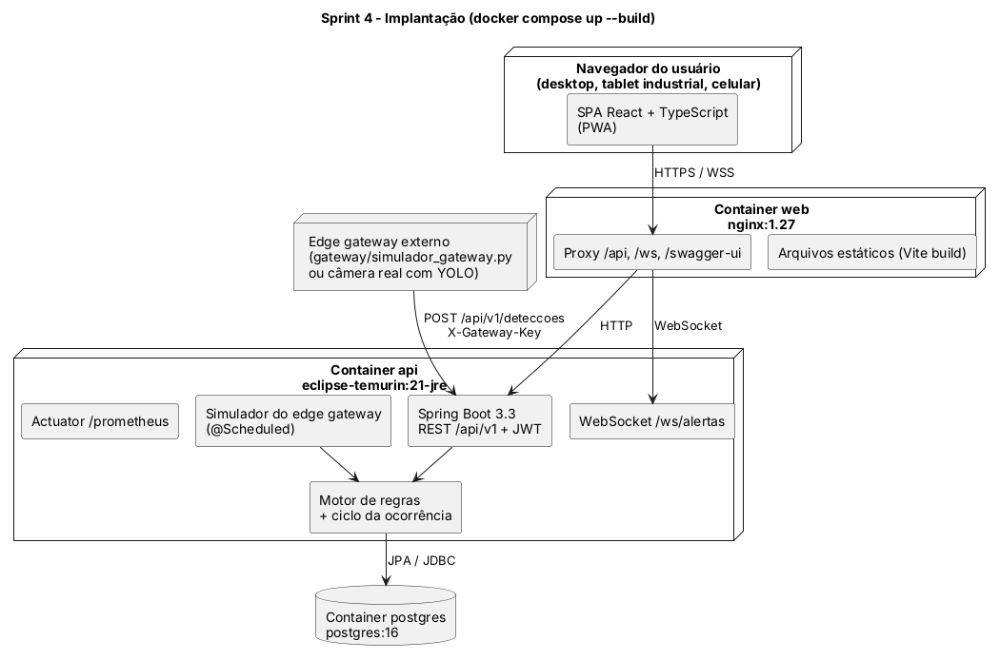
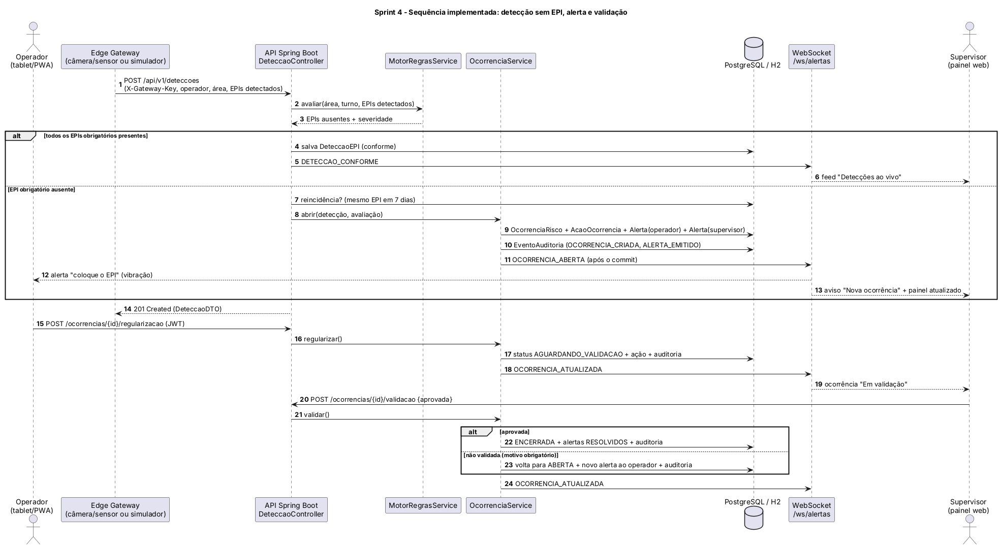
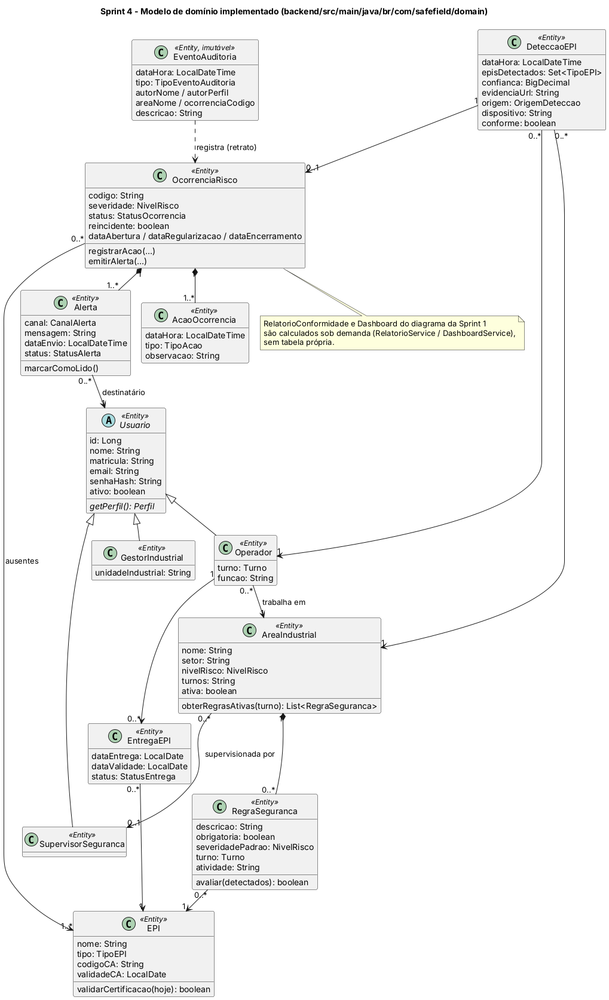

# Arquitetura Final · SafeField AI (Sprint 4)

Este documento consolida a arquitetura da solução entregue: visão geral do sistema, stack e justificativas, as
decisões técnicas tomadas ao longo das quatro Sprints, o contrato da API, o modelo de dados, a segurança e as
limitações conhecidas. Ele substitui e evolui a [arquitetura refinada da Sprint 3](arquitetura-sprint-3.md).

## 1. Visão geral

O SafeField AI recebe detecções de EPI vindas do campo (câmeras com visão computacional e sensores, via edge
gateway), avalia cada uma contra as regras de segurança da área e do turno e, quando falta um EPI obrigatório,
abre uma ocorrência, alerta operador e supervisor em tempo real e acompanha a regularização até a validação
humana. Tudo gera trilha de auditoria e alimenta indicadores de conformidade.



| Componente | Responsabilidade | Onde está |
|---|---|---|
| **Interface web (SPA/PWA)** | Telas de supervisor, gestor e operador; recebe alertas por WebSocket | `frontend/` |
| **Nginx** | Serve o build do React e faz proxy de `/api`, `/ws` e Swagger para a API (uma origem só) | `frontend/nginx.conf` |
| **API REST** | Autenticação, cadastros, ocorrências, dashboard, relatórios, auditoria | `backend/.../api` |
| **Motor de regras** | Compara EPIs detectados com as regras da área/turno e calcula a severidade | `service/MotorRegrasService` |
| **Ciclo da ocorrência** | Abertura, alertas, regularização, escalonamento, validação e encerramento | `service/OcorrenciaService` |
| **Tempo real** | Publica eventos em `/ws/alertas` depois do commit da transação | `realtime/` |
| **Simulador do edge gateway** | Substitui câmeras reais no MVP gerando detecções periódicas | `service/SimuladorService` |
| **Gateway externo (Python)** | Exemplo de integração real por HTTP com `X-Gateway-Key` | `gateway/simulador_gateway.py` |
| **Banco de dados** | PostgreSQL 16 (Docker) ou H2 em memória (local/testes) | `docker-compose.yml` |
| **Dados de demonstração** | Contexto simulado da Metaindústria com 30 dias de histórico | `seed/DataSeeder` |

### Camadas do backend

```text
api (controllers + DTOs)  →  service (regras de negócio)  →  repository (Spring Data JPA)  →  domain (entidades)
        ↑ security (JWT, perfis)                ↓ realtime (WebSocket, eventos pós-commit)
```

- Entidades JPA **nunca** saem da API: os controllers devolvem DTOs (`api/dto/Dtos.java`), mapeados dentro da
  transação (`Mapper`).
- Toda regra de negócio fica nos serviços; os controllers só autenticam, validam a entrada e delegam.
- `open-in-view` desligado: cada caso de uso carrega o que precisa com `@EntityGraph`.

## 2. Stack e justificativas

| Camada | Tecnologia | Por que |
|---|---|---|
| Backend | **Java 21 + Spring Boot 3.3** | Definido na Sprint 1: ecossistema maduro para APIs corporativas, validação, segurança e integração industrial. Java 21 traz records (DTOs) e pattern matching usados no código. |
| Persistência | **Spring Data JPA + Hibernate** | Mapeia o diagrama de classes quase 1:1 (inclusive a herança `Usuario`); consultas com `@EntityGraph` evitam N+1. |
| Banco | **PostgreSQL 16** / **H2** | PostgreSQL pela consistência transacional de ocorrências e auditoria (RNF06). H2 em memória (modo PostgreSQL) deixa o avaliador rodar sem instalar banco e acelera os testes. |
| Segurança | **Spring Security + OAuth2 Resource Server (JWT HS256)** | Tokens sem estado, como previsto na Sprint 3, sem biblioteca extra (Nimbus já vem no Spring). |
| Tempo real | **WebSocket nativo (spring-websocket)** | Atualização imediata do painel e do tablet sem polling (RNF01). |
| Documentação da API | **springdoc-openapi (Swagger UI)** | Contrato navegável e testável em `/swagger-ui.html`. |
| Observabilidade | **Actuator + Micrometer Prometheus** | `/actuator/health` e `/actuator/prometheus` prontos para Prometheus/Grafana (Sprint 1). |
| Frontend | **React 18 + TypeScript + Vite** | Definido na Sprint 1; tipagem forte espelhando os DTOs (`src/api/tipos.ts`) e build rápido. |
| Estilo | **Tailwind CSS** | Implementa o sistema visual do protótipo (alto contraste, cores de severidade, botões grandes para uso com luvas). |
| Gráficos | **Recharts** | Gráficos de conformidade e ocorrências do dashboard e dos relatórios. |
| Mobile | **PWA** (manifest) | Instalação em tablet industrial ou celular sem app nativo (Sprint 1). |
| Infraestrutura | **Docker Compose** | Sobe banco, API e web com um comando, como previsto na estratégia de deploy da Sprint 3. |

## 3. Decisões técnicas ao longo das Sprints

| Sprint | Decisão | Motivo | Situação na entrega final |
|---|---|---|---|
| 1 | Stack Java/Spring + React/TS + PostgreSQL + Docker | Robustez corporativa e manutenção | **Mantida** |
| 1 | Detecção automática nunca pune sozinha; validação humana | Cultura preventiva, não punitiva | **Implementada**: só o supervisor encerra (RN04) |
| 1 | MVP com entradas de visão computacional simuladas | Sem câmeras reais no Challenge | **Implementada**: simulador interno e script Python externo |
| 2 | Interface para tablet industrial: alto contraste, botões grandes, cores de severidade | Uso em campo, com luvas | **Implementada** no frontend (botões e campos de 42 a 52 px de altura, verde/laranja/vermelho) |
| 2 | Fluxo da ocorrência em 7 etapas visíveis | Clareza para o supervisor | **Implementada**: `LinhaDoTempo` no detalhe da ocorrência |
| 3 | API REST versionada em `/api/v1` | Contrato estável | **Implementada** (seção 4) |
| 3 | Trilha de auditoria gerada a partir das transições da ocorrência | Sem cadastro manual | **Implementada**: `AuditoriaService` chamado em cada transição e mudança de cadastro |
| 3 | Canais WebSocket por operador e por área | Cada tela recebe só o que interessa | **Implementada** como um endpoint `/ws/alertas` com filtro `?operadorId=` / `?areaId=` |
| 3 | Tópicos MQTT `safefield/deteccoes/{areaId}` entre gateway e backend | IoT industrial | **Adiada**: no MVP o gateway publica por HTTP (`POST /api/v1/deteccoes`). Ver justificativa abaixo |
| 4 | Detecções autenticadas por `X-Gateway-Key` | O gateway é um sistema, não um usuário | Nova |
| 4 | H2 por padrão e perfil `postgres` no Docker | Executar sem instalar banco | Nova |
| 4 | Eventos de tempo real só **após o commit** (`@TransactionalEventListener`) | O painel nunca mostra algo desfeito | Nova |
| 4 | Ações da ocorrência por sub-recurso (`POST /{id}/regularizacao`, `/validacao`…) no lugar de `PATCH` genérico | Cada transição tem regra e permissão próprias | Ajuste do contrato da Sprint 3 |
| 4 | Reincidência = mesmo EPI faltando de novo em até 7 dias | Indica padrão de comportamento e direciona treinamento | Nova (eleva a severidade) |
| 4 | Relatório e dashboard calculados sob demanda | Sempre consistentes com os dados | `RelatorioConformidade` e `Dashboard` viraram serviços, não tabelas |
| 4 | Horário único da planta (America/Sao_Paulo) | Consistência entre API, banco e interface | A interface exibe no fuso da planta, qualquer que seja o do navegador |
| 4 | IDs numéricos (`Long`) no lugar de UUID | Simplicidade e legibilidade no MVP; código legível `OC-00042` para as pessoas | Ajuste do diagrama de classes |

**Por que HTTP e não MQTT no MVP.** O broker MQTT faz sentido com dezenas de câmeras publicando continuamente.
No MVP há uma fonte simulada, e um broker a mais no Docker Compose aumentaria o risco de falha na avaliação sem
mudar o comportamento observável. O processamento de uma detecção está isolado em `DeteccaoService.processar`,
então um consumidor MQTT futuro só precisa chamar esse mesmo método (seção 9).

## 4. API REST (`/api/v1`)

Documentação interativa em **http://localhost:8080/swagger-ui.html**. Todas as rotas exigem
`Authorization: Bearer <token>`, exceto o login e o recebimento de detecções (que aceita `X-Gateway-Key`).

| Recurso | Método e caminho | Perfis | Requisitos |
|---|---|---|---|
| Autenticação | `POST /auth/login` · `GET /auth/me` | público · todos | RF01, RNF04 |
| Dashboard | `GET /dashboard` | supervisor, gestor | RF14 |
| Detecções | `POST /deteccoes` | gateway (`X-Gateway-Key`), supervisor, gestor | RF05, RF06 |
| Ocorrências | `GET /ocorrencias?categoria=&areaId=&severidade=&busca=&dias=` · `GET /ocorrencias/{id}` | todos (operador vê só as suas) | RF07, RF12 |
| Regularização | `POST /ocorrencias/{id}/regularizacao` | operador (dono), supervisor | RF10 |
| Validação | `POST /ocorrencias/{id}/validacao` `{aprovada, observacao}` | supervisor | RF11, RN04 |
| Escalonamento | `POST /ocorrencias/{id}/escalonamento` | supervisor | RF11 |
| Comentários | `POST /ocorrencias/{id}/comentarios` | todos | RF11 |
| Alertas | `GET /alertas` · `PATCH /alertas/{id}/lido` | destinatário | RF08, RF09 |
| Colaboradores | `GET /colaboradores` · `GET /colaboradores/{id}` · `POST /colaboradores/{id}/entregas` | supervisor, gestor (operador: só a própria ficha) | RF01, RF03, RF12 |
| EPIs | `GET /epis` · `POST /epis` | todos · supervisor, gestor | RF03 |
| Áreas | `GET/POST /areas` · `GET/PUT /areas/{id}` | todos · supervisor, gestor | RF02 |
| Regras | `GET/POST /areas/{id}/regras` · `DELETE /areas/{id}/regras/{regraId}` | supervisor, gestor | RF03, RF04 |
| Auditoria | `GET /auditoria?inicio=&fim=&areaId=&tipo=&autor=&ocorrenciaId=` | supervisor, gestor | RF15, RNF03 |
| Relatórios | `GET /relatorios/conformidade` · `GET /relatorios/conformidade.csv` | supervisor, gestor | RF13 |
| Usuários | `GET /usuarios` · `POST /usuarios` | supervisor, gestor · gestor | RF01 |
| Simulador | `GET/PUT /simulador` · `POST /simulador/deteccoes` | supervisor, gestor | Restrição do MVP |
| Referências | `GET /referencias` | todos | Listas de valores |

Erros seguem um formato único: `{status, erro, mensagem, detalhes[]}` com 400 (dados inválidos), 401, 403,
404 e 422 (regra de negócio, por exemplo validar uma ocorrência que não está em validação).

**Exemplo: detecção vinda do gateway**

```bash
curl -X POST http://localhost:8080/api/v1/deteccoes \
  -H "X-Gateway-Key: gateway-dev-key" -H "Content-Type: application/json" \
  -d '{"operadorId": 4, "areaId": 5, "episDetectados": ["BOTA"], "confianca": 0.93, "dispositivo": "CAM-MON-01"}'
```

## 5. Fluxo crítico em tempo real



1. O gateway (ou o simulador) envia a detecção com os EPIs reconhecidos.
2. `MotorRegrasService` seleciona as regras obrigatórias da área válidas no **turno do horário da detecção**
   (A 06h–14h, B 14h–22h, C 22h–06h) e lista os EPIs ausentes.
3. A severidade é a maior entre as regras violadas, sobe um nível se faltarem 2 ou mais EPIs e mais um se o
   mesmo EPI já tiver faltado para o operador nos 7 dias anteriores.
4. `OcorrenciaService.abrir` cria a ocorrência, registra as ações, emite **dois alertas ao mesmo tempo** (RN03),
   um para o operador e outro para o supervisor da área, e grava os eventos de auditoria.
5. Depois do commit, `AlertasWebSocketHandler` envia `OCORRENCIA_ABERTA`: o tablet do operador vibra e mostra o
   EPI a colocar, e o painel do supervisor exibe o aviso e se atualiza.
6. O operador confirma a regularização (status **Em validação**) e o supervisor valida (status **Encerrada**) ou
   rejeita com motivo (volta para **Aguardando regularização**, com novo alerta).

Ciclo de vida da ocorrência:

```text
ABERTA ──escalar──▶ ESCALADA
  │                    │
  └──regularizar──┬────┘
                  ▼
        AGUARDANDO_VALIDACAO ──validar(aprovada)──▶ ENCERRADA
                  │
                  └──validar(rejeitada, motivo)──▶ ABERTA (novo alerta ao operador)
```

## 6. Modelo de dados



Evolução em relação ao [diagrama de classes da Sprint 1](diagramas/png/classes.png):

| Sprint 1 | Implementação | Observação |
|---|---|---|
| `Usuario` ← `Operador`, `SupervisorSeguranca`, `GestorIndustrial` | Herança JPA em tabela única (`perfil`) | Senha com BCrypt |
| `AreaIndustrial`, `EPI`, `RegraSeguranca` | Iguais, mais `setor`, `turnos`, `codigoCA`/`validadeCA`, `turno`/`atividade` na regra | O CA vencido bloqueia novas entregas |
| `DeteccaoEPI` | `episDetectados` (tipos reconhecidos), `origem`, `dispositivo`, `conforme` | Toda detecção é guardada, inclusive as conformes, para calcular o índice de conformidade |
| `OcorrenciaRisco`, `Alerta`, `AcaoOcorrencia` | Iguais, mais `codigo`, `reincidente` e datas de regularização/encerramento | |
| `RelatorioConformidade`, `Dashboard` | `RelatorioService`, `DashboardService` | Calculados sob demanda |
| (novo) `EntregaEPI` | Ficha de entrega de EPI ao colaborador | Registros de EPIs por colaborador |
| (novo) `EventoAuditoria` | Registro imutável com retrato de autor/área | RF15 / RNF03 |

## 7. Segurança e privacidade

| Tema | Como foi tratado |
|---|---|
| Autenticação | Login com e-mail e senha (BCrypt), token JWT HS256 válido por 12 h (`safefield.jwt.*`) |
| Autorização | Perfil no token → `ROLE_OPERADOR/SUPERVISOR/GESTOR`; `@PreAuthorize` nos controllers e regras finas nos serviços (o operador só vê e regulariza as próprias ocorrências; só o supervisor valida e escala; só o gestor cria usuários) |
| Gateway | Chave `X-Gateway-Key` comparada em tempo constante; o operador não consegue publicar detecções |
| Canais seguros (RNF04) | Em produção, TLS no Nginx (HTTPS/WSS); no ambiente de avaliação é HTTP local |
| Auditoria (RNF03) | Entidade `@Immutable`, sem endpoints de alteração ou exclusão |
| LGPD (RNF10) | Só os dados necessários (nome, matrícula, e-mail corporativo, área e turno); a evidência é guardada como referência (caminho), não como imagem do rosto |
| Validação de entrada | Bean Validation nos DTOs; erros padronizados |

## 8. Qualidade

- **Testes automatizados** (`./mvnw test`): `MotorRegrasServiceTest` (6 cenários do motor e dos turnos) e
  `FluxoOcorrenciaApiTest` (5 cenários de ponta a ponta pela API: detecção → ocorrência → regularização →
  rejeição sem motivo → validação → auditoria; detecção conforme; controle de acesso por perfil; dashboard,
  relatório e CSV; cadastro de área e regra auditado). No frontend, `npm test` cobre formatação e fuso horário.
- **Verificação em navegador:** os fluxos do roteiro de avaliação do README foram executados no Chromium, em
  desktop, tablet e celular, sem erros no console.
- **Perfil PostgreSQL** validado contra um PostgreSQL 16 real, com todos os endpoints respondendo.

## 9. Limitações conhecidas e próximos passos

| Limitação do MVP | Próximo passo |
|---|---|
| Sem câmeras reais: detecções simuladas | Edge gateway com Python + OpenCV + YOLO publicando no mesmo `POST /deteccoes` (ou via MQTT) |
| Gateway → API por HTTP | Broker MQTT (`safefield/deteccoes/{areaId}`) com consumidor chamando `DeteccaoService.processar` |
| A atividade da regra é informativa (a câmera não informa a atividade) | Receber a atividade da ordem de produção ou do posto de trabalho |
| Notificação ao operador só com o app aberto (WebSocket) | Web Push / notificação nativa do PWA |
| Banco recriado a cada subida (ambiente de avaliação) | Migrações com Flyway e `ddl-auto=validate` em produção |
| Uma instância da API (WebSocket em memória) | Broker de mensagens (Redis/RabbitMQ) para escalar horizontalmente (RNF08) |
| Evidência guardada como caminho | Armazenamento de objetos (S3/MinIO) com retenção conforme a LGPD |
| Autenticação própria | Integração com o SSO corporativo (fora do escopo desde a Sprint 1) |
