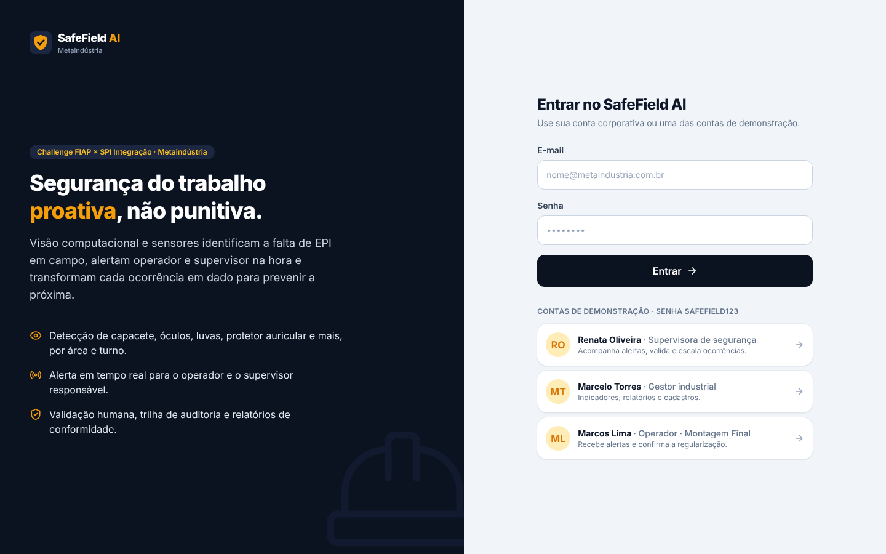
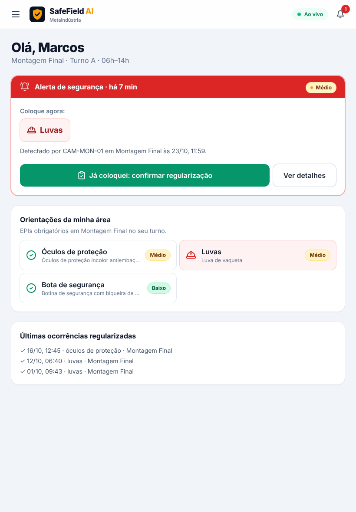
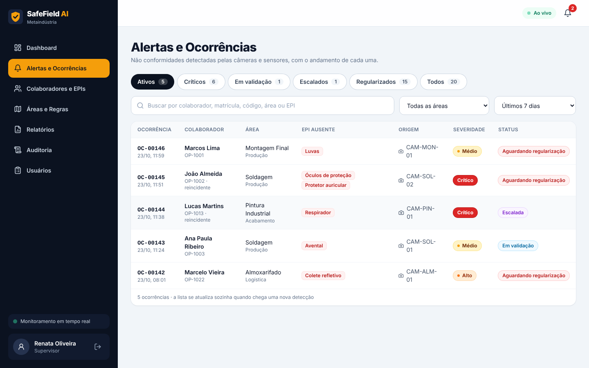
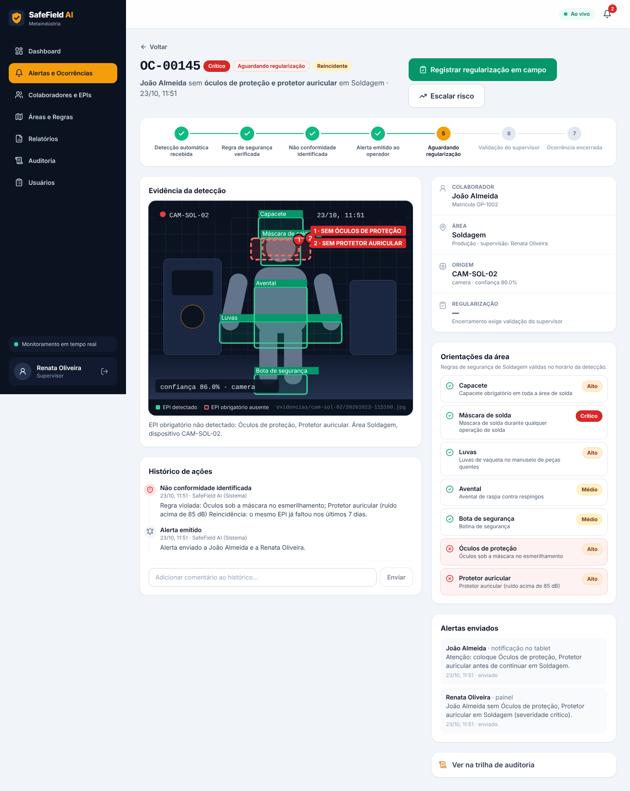
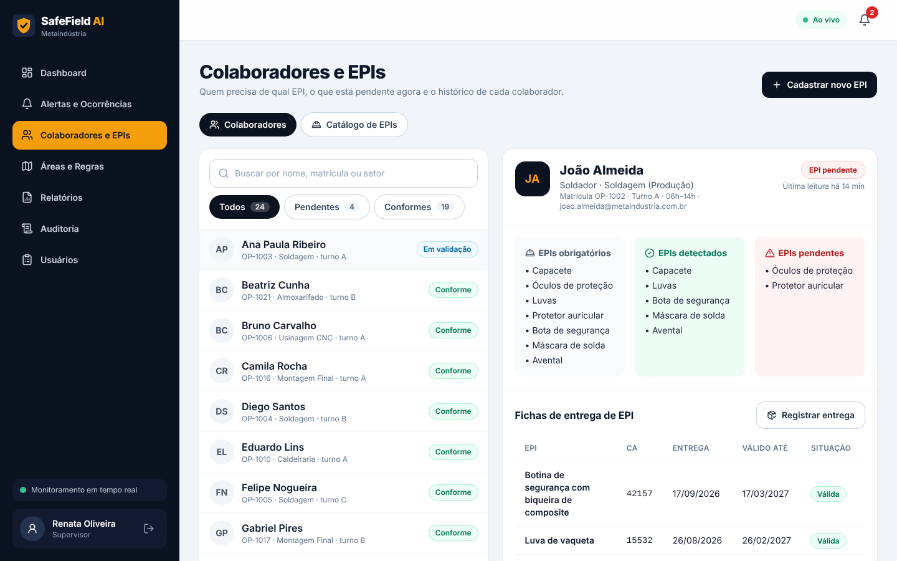
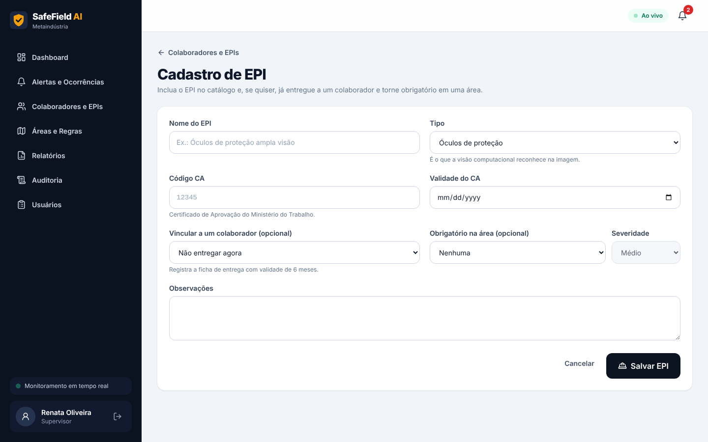
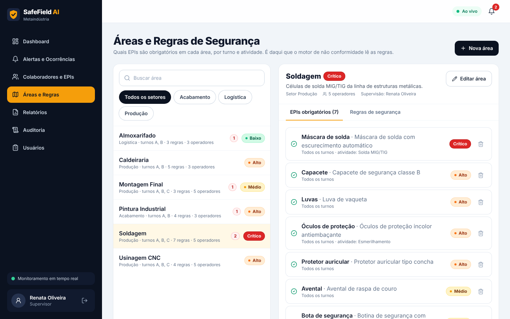
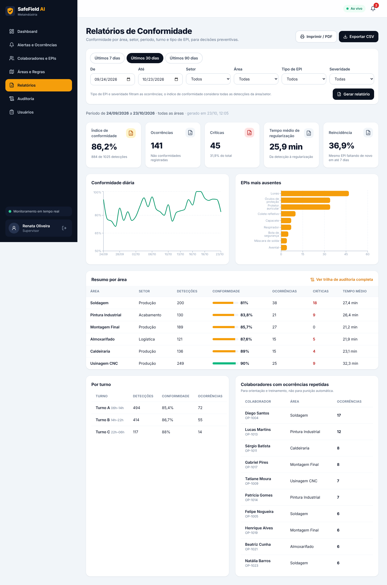
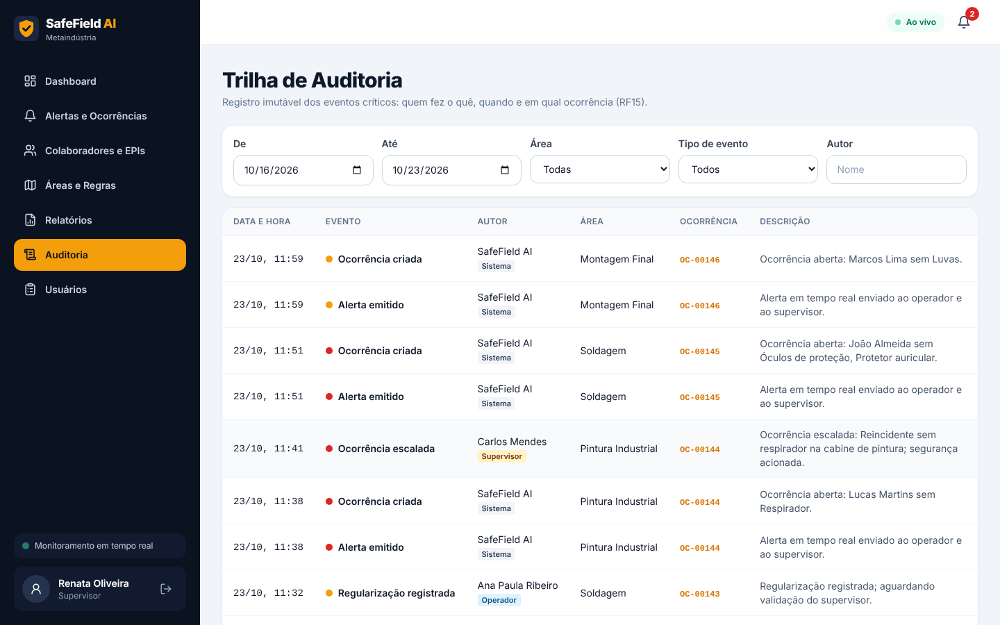

# Manual de Uso · SafeField AI

Guia de uso da aplicação para cada perfil. Para instalar e executar, veja a seção
[Como executar](../README.md#2-como-executar) do README.

## Acesso

Abra **http://localhost:3000** (Docker) ou **http://localhost:5173** (sem Docker). Na tela de login, digite
e-mail e senha ou clique em uma das **contas de demonstração** (senha `safefield123`):

| Conta | Perfil | Use para |
|---|---|---|
| Renata Oliveira · `supervisor@metaindustria.com.br` | Supervisora de segurança | Acompanhar alertas, validar e escalar ocorrências, configurar áreas e EPIs |
| Marcelo Torres · `gestor@metaindustria.com.br` | Gestor industrial | Indicadores, relatórios, auditoria, cadastro de usuários |
| Marcos Lima · `operador@metaindustria.com.br` | Operador (Montagem Final) | Receber alertas e confirmar a regularização do EPI |

O menu lateral muda conforme o perfil. No canto superior direito ficam o indicador **Ao vivo** (conexão de
tempo real ativa) e o **sino** com os alertas não lidos. Em tablet e celular, o menu abre pelo botão ☰.



---

## Operador de chão de fábrica

### Meus alertas

É a tela inicial do operador, pensada para tablet industrial e uso com luvas.



1. Quando uma câmera detecta a falta de um EPI, aparece um **cartão vermelho "Alerta de segurança"** com o EPI
   a colocar (por exemplo, **Luvas**). Com a tela aberta, o aviso chega na hora e o aparelho vibra.
2. Coloque o EPI e toque em **Já coloquei: confirmar regularização**. Se quiser, escreva um comentário e toque
   em **Sim, confirmar**.
3. A ocorrência passa para **Aguardando validação do supervisor**. Se o supervisor não validar (por exemplo, EPI
   colocado de forma errada), um novo alerta chega com o motivo.
4. Em **Orientações da minha área** estão os EPIs obrigatórios da sua área no seu turno, com destaque vermelho
   no que está pendente.

### Meus EPIs

Mostra os EPIs obrigatórios, detectados e pendentes, as **fichas de entrega** (com validade; as vencidas
aparecem como "Vencida: trocar") e o histórico das suas ocorrências.

---

## Supervisor de segurança

### Dashboard de Monitoramento


- **Indicadores:** alertas ativos (críticos, em validação e escalados), conformidade de hoje e dos últimos 7
  dias (com a variação em relação à semana anterior), tempo médio de regularização e reincidência.
- **Gráfico de 7 dias:** ocorrências, críticas e linha de conformidade.
- **Simulador de câmeras:** no MVP, as câmeras são simuladas.
  - O interruptor liga ou desliga a geração automática (uma detecção a cada 25 s).
  - **Simular operador sem EPI** gera agora uma detecção com EPI faltando, e o aviso "Nova ocorrência" aparece
    em cerca de 1 segundo.
  - **Simular detecção conforme** gera uma leitura com todos os EPIs.
- **Ocorrências ativas:** ordenadas por severidade; clique para abrir.
- **Detecções ao vivo:** cada leitura das câmeras, conforme (verde) ou não (vermelho), chegando em tempo real.
- **Áreas industriais:** conformidade de cada área na semana e as ocorrências ativas.

### Alertas e Ocorrências



1. Use as abas **Ativos, Críticos, Em validação, Escalados, Regularizados e Todos**. Cada aba mostra quantas
   ocorrências contém.
2. Busque por colaborador, matrícula, código, área ou EPI; filtre por área e período.
3. A lista se atualiza sozinha quando chega uma detecção, e as novas ocorrências piscam em amarelo.

### Detalhe da ocorrência



- **Fluxo em 7 etapas:** detecção, regra verificada, não conformidade, alerta, aguardando regularização,
  validação e encerramento.
- **Evidência da detecção:** quadro da câmera com caixas verdes para os EPIs detectados e vermelhas numeradas
  para os ausentes, com dispositivo, horário e confiança.
- **Orientações da área:** as regras em vigor, com os itens violados em vermelho.
- **Histórico de ações** e **alertas enviados** (para o operador e para você).

Ações disponíveis conforme o status:

| Status | Ação | Efeito |
|---|---|---|
| Aguardando regularização | **Registrar regularização em campo** | Use quando você mesmo conferiu a correção; vai para "Em validação" |
| Aguardando regularização | **Escalar risco** | Para risco crítico ou reincidente: os gestores são alertados |
| Em validação | **Validar regularização** | Encerra a ocorrência e resolve os alertas |
| Em validação | **Não validar** | Exige motivo; a ocorrência volta e o operador recebe novo alerta |
| Qualquer | **Comentário** | Fica no histórico e na auditoria |

> A detecção automática nunca encerra uma ocorrência sozinha: o encerramento exige a sua validação (RN04).

### Colaboradores e EPIs



1. Busque por nome, matrícula ou setor e filtre por **Pendentes** ou **Conformes**.
2. A ficha mostra os **EPIs obrigatórios** (pela área e pelo turno), os **detectados** e os **pendentes**, as
   **fichas de entrega** e o **histórico de ocorrências**.
3. **Registrar entrega** entrega um EPI do catálogo ao colaborador (validade de 6 meses, limitada à validade do
   CA). EPIs com **CA vencido** não podem ser entregues.
4. A aba **Catálogo de EPIs** lista os EPIs com CA e a situação do certificado.

### Cadastro de EPI



Em **Cadastrar novo EPI** informe nome, tipo (o que a câmera reconhece), código CA (3 a 6 dígitos), validade
do CA e observações. Também dá para, no mesmo formulário, **entregar a um colaborador** e **torná-lo
obrigatório em uma área** com uma severidade. Ao salvar, aparece a confirmação com tudo que foi feito.

### Áreas e Regras de Segurança



1. Selecione uma área para ver os **EPIs obrigatórios** (regras) com severidade, turno e atividade.
2. **Adicionar EPI obrigatório:** escolha o EPI, a severidade se ele faltar, o turno (ou todos) e, se quiser, a
   atividade. A regra vale imediatamente para as próximas detecções.
3. O ícone de lixeira remove uma regra.
4. **Nova área** e **Editar área:** nome, setor, nível de risco, turnos de operação, supervisor responsável,
   descrição e se a área está ativa (áreas inativas não recebem detecções).
5. A aba **Regras de segurança** explica como o motor avalia as detecções daquela área.

Todas as alterações vão para a trilha de auditoria.

---

## Gestor industrial

O gestor também vê Dashboard, Alertas, Colaboradores e Áreas. Ele não valida nem escala ocorrências, porque
isso é papel do supervisor.

### Relatórios de Conformidade



1. Escolha um período rápido (**7, 30 ou 90 dias**) ou datas específicas, e filtre por setor, área, tipo de
   EPI e severidade. Depois clique em **Gerar relatório**.
2. O relatório mostra:
   - índice de conformidade, total de ocorrências, críticas, tempo médio de regularização e reincidência;
   - conformidade diária e EPIs mais ausentes;
   - resumo por área, por turno e colaboradores com ocorrências repetidas (para orientação e treinamento, não
     para punição).
3. **Exportar CSV** baixa o relatório pronto para o Excel. **Imprimir / PDF** usa a impressão do navegador.
4. **Ver trilha de auditoria completa** abre a auditoria com o mesmo período e área.

### Trilha de Auditoria



Registro imutável de todos os eventos críticos: criação de ocorrência, alertas, regularizações, validações
(aprovadas e rejeitadas), escalonamentos, comentários e mudanças de cadastro (áreas, regras, EPIs, entregas,
usuários). Filtre por período, área, tipo de evento e autor; clique numa linha para abrir a ocorrência.

### Usuários

Lista operadores, supervisores e gestores. Só o gestor pode cadastrar: em **Novo usuário**, escolha o perfil e
preencha os dados (o operador precisa de área e turno).

---

## Integração do edge gateway (técnico)

Câmeras e sensores publicam detecções na API com a chave do gateway:

```bash
# envia detecções aleatórias a cada 5 s (30% com EPI faltando)
python3 gateway/simulador_gateway.py

# uma detecção específica: operador 4, área 5, só a botina detectada
python3 gateway/simulador_gateway.py --operador 4 --area 5 --epis BOTA
```

A documentação completa da API fica em **http://localhost:8080/swagger-ui.html**. Para testar endpoints
protegidos, faça login em `POST /api/v1/auth/login`, copie o `token` e use o botão **Authorize**.

## Dúvidas frequentes

| Situação | O que fazer |
|---|---|
| "Não foi possível falar com a API" | A API ainda está subindo. Aguarde o log `Dados de demonstração da Metaindústria criados` e recarregue |
| Indicador "Offline" no topo | A conexão de tempo real caiu; ela reconecta sozinha em alguns segundos |
| Quero recomeçar do zero | Reinicie a API (ou `docker compose down` e `docker compose up`): os dados de demonstração são recriados |
| Porta 8080, 3000 ou 5173 ocupada | Encerre o programa que usa a porta ou ajuste as portas no `docker-compose.yml` |
